<h1 align="center">pazhik</h1>

<b>I build AI agents, DeFi tooling, and on-chain applications (MonteNegroX).</b> 34 public repositories (2 original, 32 open-source forks) and 8 merged upstream PRs.

<picture><source media="(prefers-color-scheme: dark)" srcset="./assets/stats-dark.svg"/><source media="(prefers-color-scheme: light)" srcset="./assets/stats-light.svg"/></picture>

<picture><source media="(prefers-color-scheme: dark)" srcset="./assets/planet-dark.svg"/><source media="(prefers-color-scheme: light)" srcset="./assets/planet-light.svg"/></picture>

## About

I'm **pazhik** ([@MonteNegroX](https://github.com/MonteNegroX)), currently diving deep into **AI & Machine Learning**, **autonomous agents**, and **on-chain DeFi systems**.

I build full-stack TypeScript, Next.js, Python, and Web3 software across Solana and EVM ecosystems — from agentic KOL campaign platforms with Solana escrow ([frame-ambassadors](https://github.com/MonteNegroX/frame-ambassadors)) to consumer pack-opening apps settled on Robinhood Chain and Hyperliquid ([gacha-capsule](https://github.com/MonteNegroX/gacha-capsule)).

Alongside my own projects, I contribute to open-source AI and DeFi ecosystems, including merged adapters and translations for [DefiLlama](https://github.com/DefiLlama/DefiLlama-Adapters), [OmniRoute](https://github.com/cheaper-inference/OmniRoute), [worldmonitor](https://github.com/koala73/worldmonitor), [gpt-researcher](https://github.com/assafelovic/gpt-researcher), and [OpenLogi](https://github.com/AprilNEA/OpenLogi).

Core stack: **TypeScript**, **Python**, **React / Next.js**, **Node.js**, **Solana / EVM**, **Figma**, and **Unity**. You can also find me on [X (@pazhik_ido)](https://twitter.com/pazhik_ido), [LinkedIn](https://linkedin.com/in/eremenko-defi), and [YouTube (@cryptoXforest)](https://www.youtube.com/@cryptoXforest).

## Start here

- [frame-ambassadors](https://github.com/MonteNegroX/frame-ambassadors) ★1: Agentic KOL campaign platform with Solana escrow
- [gacha-capsule](https://github.com/MonteNegroX/gacha-capsule): Next.js site and pack worker for Capsule: $25 graded packs & Garage Packs with USDG on Robinhood Chain and USDC on Hyperliquid.
- [koala73/worldmonitor](https://github.com/koala73/worldmonitor) ★91178: merged [#5865](https://github.com/koala73/worldmonitor/pull/5865): Real-time global intelligence dashboard. AI-powered news aggregation, geopolitical monitoring, and...
- [cheaper-inference/OmniRoute](https://github.com/cheaper-inference/OmniRoute) ★90312: merged [#8217](https://github.com/cheaper-inference/OmniRoute/pull/8217): Never stop coding. Free MIT AI gateway: one endpoint, 375 providers (150+ free), 1,400+ models Kimi, Claude...
- [virgiliojr94/book-to-skill](https://github.com/virgiliojr94/book-to-skill) ★39025: merged [#147](https://github.com/virgiliojr94/book-to-skill/pull/147): Turn any technical book PDF into a Claude Code skill: ready to study, reference, and use while you work.
- [assafelovic/gpt-researcher](https://github.com/assafelovic/gpt-researcher) ★30907: merged [#2083](https://github.com/assafelovic/gpt-researcher/pull/2083): An autonomous agent that conducts deep research on any data using any LLM providers

<picture><source media="(prefers-color-scheme: dark)" srcset="./assets/top-stars-dark.svg"/><source media="(prefers-color-scheme: light)" srcset="./assets/top-stars-light.svg"/></picture>

## By the numbers

Every chart below is rendered from the live GitHub listing each time the catalog is rebuilt, so the numbers are always current.

<picture><source media="(prefers-color-scheme: dark)" srcset="./assets/city-dark.svg"/><source media="(prefers-color-scheme: light)" srcset="./assets/city-light.svg"/></picture>

<picture><source media="(prefers-color-scheme: dark)" srcset="./assets/growth-dark.svg"/><source media="(prefers-color-scheme: light)" srcset="./assets/growth-light.svg"/></picture>
<picture><source media="(prefers-color-scheme: dark)" srcset="./assets/languages-dark.svg"/><source media="(prefers-color-scheme: light)" srcset="./assets/languages-light.svg"/></picture>

<picture><source media="(prefers-color-scheme: dark)" srcset="./assets/punchcard-dark.svg"/><source media="(prefers-color-scheme: light)" srcset="./assets/punchcard-light.svg"/></picture>

## How I build

Pulled from the GitHub API on November 25, 2026. Contribution counts and streaks include private repositories as counts only. Lines and hours come from public non-fork repositories, with any commit over 20,000 changed lines left out as a bulk import. Hours are not a stopwatch: a day counts each clock hour (UTC) in which at least one commit landed, so it cannot pass 24.

<picture><source media="(prefers-color-scheme: dark)" srcset="./assets/activity-volume-dark.svg"/><source media="(prefers-color-scheme: light)" srcset="./assets/activity-volume-light.svg"/></picture>

<picture><source media="(prefers-color-scheme: dark)" srcset="./assets/activity-habit-dark.svg"/><source media="(prefers-color-scheme: light)" srcset="./assets/activity-habit-light.svg"/></picture>

<picture><source media="(prefers-color-scheme: dark)" srcset="./assets/activity-calendar-dark.svg"/><source media="(prefers-color-scheme: light)" srcset="./assets/activity-calendar-light.svg"/></picture>

<picture><source media="(prefers-color-scheme: dark)" srcset="./assets/activity-lines-dark.svg"/><source media="(prefers-color-scheme: light)" srcset="./assets/activity-lines-light.svg"/></picture>

<picture><source media="(prefers-color-scheme: dark)" srcset="./assets/activity-hours-dark.svg"/><source media="(prefers-color-scheme: light)" srcset="./assets/activity-hours-light.svg"/></picture>

<picture><source media="(prefers-color-scheme: dark)" srcset="./assets/activity-rhythm-dark.svg"/><source media="(prefers-color-scheme: light)" srcset="./assets/activity-rhythm-light.svg"/></picture>

- Busiest day: June 23, 2025 with 78 contributions.
- Biggest day for lines: August 28, 2026 with 16,972 lines changed.
- Most hours with a push in one day: 8 on October 11, 2026.
- Last 30 days: 0 contributions, 0 lines added and 0 removed across 0 active days.
- Current streak: 0 days. Longest: 8 days, ending July 11, 2025.

| Where the lines went | Commits | Added | Removed |
|---|---:|---:|---:|
| [gacha-capsule](https://github.com/MonteNegroX/gacha-capsule) | 39 | 32,163 | 4,666 |
| [frame-ambassadors](https://github.com/MonteNegroX/frame-ambassadors) | 45 | 6,698 | 15,461 |

## Open-source contributions

8 merged pull requests in 8 repositories maintained by other people and teams, since 2026. Every pull request I authored that a maintainer merged outside my own account, read live from GitHub.

8 repositories

- [koala73/worldmonitor](https://github.com/koala73/worldmonitor) ★91178, merged [#5865](https://github.com/koala73/worldmonitor/pull/5865): Real-time global intelligence dashboard. AI-powered news aggregation, geopolitical monitoring, and infrastructure tracking in a unified...
- [cheaper-inference/OmniRoute](https://github.com/cheaper-inference/OmniRoute) ★90312, merged [#8217](https://github.com/cheaper-inference/OmniRoute/pull/8217): Never stop coding. Free MIT AI gateway: one endpoint, 375 providers (150+ free), 1,400+ models Kimi, Claude, GPT, Gemini, GLM, DeepSeek...
- [virgiliojr94/book-to-skill](https://github.com/virgiliojr94/book-to-skill) ★39025, merged [#147](https://github.com/virgiliojr94/book-to-skill/pull/147): Turn any technical book PDF into a Claude Code skill: ready to study, reference, and use while you work.
- [assafelovic/gpt-researcher](https://github.com/assafelovic/gpt-researcher) ★30907, merged [#2083](https://github.com/assafelovic/gpt-researcher/pull/2083): An autonomous agent that conducts deep research on any data using any LLM providers
- [AprilNEA/OpenLogi](https://github.com/AprilNEA/OpenLogi) ★26191, merged [#1039](https://github.com/AprilNEA/OpenLogi/pull/1039): ⚡️A native, local-first alternative to Logitech Options+, written in Rust 🦀: remap buttons, DPI, and SmartShift over HID++. No account, no...
- [agegr/pi-web](https://github.com/agegr/pi-web) ★8406, merged [#313](https://github.com/agegr/pi-web/pull/313): Web UI for the pi coding agent
- [DefiLlama/DefiLlama-Adapters](https://github.com/DefiLlama/DefiLlama-Adapters) ★1281, merged [#21565](https://github.com/DefiLlama/DefiLlama-Adapters/pull/21565)
- [DefiLlama/dimension-adapters](https://github.com/DefiLlama/dimension-adapters) ★220, merged [#10089](https://github.com/DefiLlama/dimension-adapters/pull/10089)

## Find your way

Jump to a section below, or read the machine-readable catalog in [repos.json](./repos.json).

- [Original projects](#original-projects) (2)
- [DeFi & on-chain tooling](#defi-on-chain-tooling) (3)
- [AI agents & memory](#ai-agents-memory) (13)
- [Browser automation & scraping](#browser-automation-scraping) (6)
- [Local inference & self-hosted](#local-inference-self-hosted) (7)
- [Gaming & experiments](#gaming-experiments) (3)

## Original projects

Built from scratch: agentic platforms, Solana escrow, and consumer on-chain applications.

2 repositories

- [frame-ambassadors](https://github.com/MonteNegroX/frame-ambassadors) ★1: Agentic KOL campaign platform with Solana escrow
- [gacha-capsule](https://github.com/MonteNegroX/gacha-capsule): Next.js site and pack worker for Capsule: $25 graded packs & Garage Packs with USDG on Robinhood Chain and USDC on Hyperliquid.

## DeFi & on-chain tooling

Protocol adapters, TVL/fee indexers, and on-chain agent tooling.

3 repositories

- [DefiLlama-Adapters](https://github.com/MonteNegroX/DefiLlama-Adapters) _(fork)_: Fork for contributing DeFiLlama TVL adapters (merged Capsule TVL adapter on Robinhood Chain).
- [dimension-adapters](https://github.com/MonteNegroX/dimension-adapters) _(fork)_: Fork for contributing DeFiLlama fees & volume adapters (merged Capsule adapter on Robinhood Chain).
- [milkymom-agent](https://github.com/MonteNegroX/milkymom-agent) _(fork)_: Nosana Builders' Challenge: Agent 101

## AI agents & memory

Autonomous coding agents, context databases, skills, and multi-agent hubs.

13 repositories

- [hermes-agent](https://github.com/MonteNegroX/hermes-agent) _(fork)_: The agent that grows with you
- [OmniRoute](https://github.com/MonteNegroX/OmniRoute) _(fork)_: Never stop coding. Free MIT AI gateway: one endpoint, 268+ providers (50+ free), 500+ models: Kimi, Claude, GPT, OpenAI, Gemini, GLM...
- [LibreChat](https://github.com/MonteNegroX/LibreChat) _(fork)_: Enhanced ChatGPT Clone: Features Agents, MCP, Skills, DeepSeek, Anthropic, AWS, OpenAI, Responses API, Azure, Groq, o1, GPT-5, Mistral...
- [OpenViking](https://github.com/MonteNegroX/OpenViking) _(fork)_: Self-evolving Context Database for AI Agents. Unify Agent Memory, Knowledge RAG and Skills.
- [aider](https://github.com/MonteNegroX/aider) _(fork)_: aider is AI pair programming in your terminal
- [DeepSeek-Reasonix](https://github.com/MonteNegroX/DeepSeek-Reasonix) _(fork)_: DeepSeek-native AI coding agent for your terminal. Engineered around prefix-cache stability: leave it running.
- [gpt-researcher](https://github.com/MonteNegroX/gpt-researcher) _(fork)_: An autonomous agent that conducts deep research on any data using any LLM providers
- [WrenAI](https://github.com/MonteNegroX/WrenAI) _(fork)_: GenBI (Generative BI) for AI agents, an open-source, governed text-to-SQL through an open context layer that turns natural-language...
- [TencentDB-Agent-Memory](https://github.com/MonteNegroX/TencentDB-Agent-Memory) _(fork)_: TencentDB Agent Memory is a team-level memory hub for AI Agents: turning conversations, docs, and code into four reusable memory assets...
- [Octop](https://github.com/MonteNegroX/Octop) _(fork)_: A smarter, self-hosted AI assistant: multi-user, multi-agent.
- [CanvasTTY](https://github.com/MonteNegroX/CanvasTTY) _(fork)_: Your infinite desktop just for your AI agents. Inspired by DriftWM.
- [pi-web](https://github.com/MonteNegroX/pi-web) _(fork)_: Web UI for the pi coding agent
- [book-to-skill](https://github.com/MonteNegroX/book-to-skill) _(fork)_: Turn any technical book PDF into a Claude Code skill: ready to study, reference, and use while you work.

## Browser automation & scraping

Browser agent SDKs, web scraping APIs, and code intelligence tooling.

6 repositories

- [firecrawl](https://github.com/MonteNegroX/firecrawl) _(fork)_: The API to search, scrape, and interact with the web at scale. 🔥
- [stagehand](https://github.com/MonteNegroX/stagehand) _(fork)_: The SDK For Browser Agents
- [browser-use-broken-fork](https://github.com/MonteNegroX/browser-use-broken-fork) _(fork)_: 🌐 Make websites accessible for AI agents. Automate tasks online with ease.
- [code-review-graph](https://github.com/MonteNegroX/code-review-graph) _(fork)_: Local-first code intelligence graph for MCP and CLI. Builds a persistent map of your codebase so AI coding tools read only what matters...
- [ego-lite](https://github.com/MonteNegroX/ego-lite) _(fork)_: The fastest browser for AI agents to run browser automation, built for sharing your logged-in browser state with your AI agents, like Codex...
- [markitdown](https://github.com/MonteNegroX/markitdown) _(fork)_: Python tool for converting files and office documents to Markdown.

## Local inference & self-hosted

Local LLM runtimes, self-hosted dashboards, PaaS, and native tools.

7 repositories

- [MoneyPrinterTurbo](https://github.com/MonteNegroX/MoneyPrinterTurbo) _(fork)_: 利用 AI 大模型和自动化工作流，根据主题或关键词一键生成高清短视频。Generate HD short videos from a topic or keyword with an automated AI workflow.
- [llama.cpp](https://github.com/MonteNegroX/llama.cpp) _(fork)_: LLM inference in C/C++
- [worldmonitor](https://github.com/MonteNegroX/worldmonitor) _(fork)_: Real-time global intelligence dashboard. AI-powered news aggregation, geopolitical monitoring, and infrastructure tracking in a unified...
- [coolify](https://github.com/MonteNegroX/coolify) _(fork)_: An open-source, self-hostable PaaS alternative to Vercel, Heroku & Netlify that lets you easily deploy static sites, databases, full-stack...
- [memos](https://github.com/MonteNegroX/memos) _(fork)_: Open-source, self-hosted note-taking tool built for quick capture. Markdown-native, lightweight, and fully yours.
- [OpenLogi](https://github.com/MonteNegroX/OpenLogi) _(fork)_: ⚡️A native, local-first alternative to Logitech Options+, written in Rust 🦀: remap buttons, DPI, and SmartShift over HID++. No account, no...
- [airllm](https://github.com/MonteNegroX/airllm) _(fork)_: AirLLM 70B inference with single 4GB GPU

## Gaming & experiments

Game economy simulators and early web experiments.

3 repositories

- [cs2-inventory-simulator](https://github.com/MonteNegroX/cs2-inventory-simulator) _(fork)_: A Counter-Strike 2 Inventory Simulator
- [VGO](https://github.com/MonteNegroX/VGO) _(fork)_: case opening site
- [CS-GO-OpenCase-Simulator](https://github.com/MonteNegroX/CS-GO-OpenCase-Simulator) _(fork)_: Simulator of CS:GO Opencase, Contracts, Roulette, Coinflip games.

## Say hi

If something here helped you, a star takes one click. [Follow @MonteNegroX](https://github.com/MonteNegroX) for new work, or reach out on [X (@pazhik_ido)](https://twitter.com/pazhik_ido), [LinkedIn](https://linkedin.com/in/eremenko-defi), or [YouTube](https://www.youtube.com/@cryptoXforest).

Coding agents and LLM tooling can read this profile directly: [AGENTS.md](./AGENTS.md), [llms.txt](./llms.txt) and [repos.json](./repos.json). Previous profile version is backed up in [README.backup.md](./README.backup.md).

Catalog and charts regenerated from the live GitHub listing: 34 repositories (2 original), 8 merged upstream PRs, 1 star.

